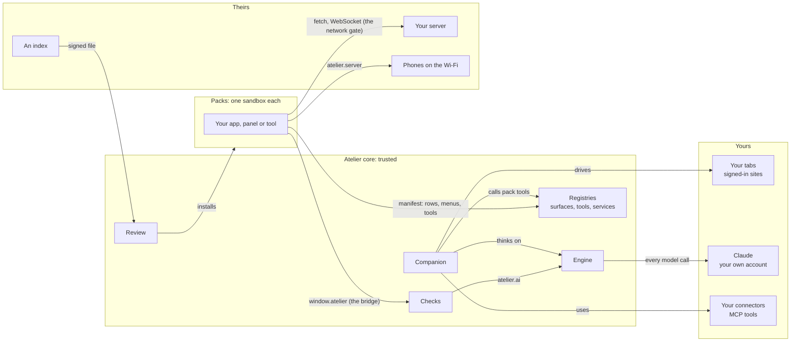
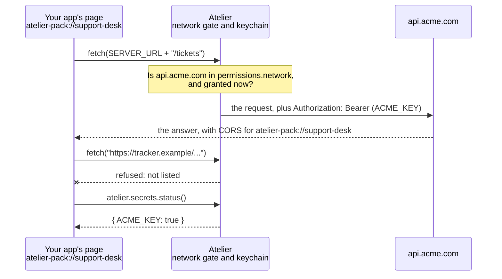
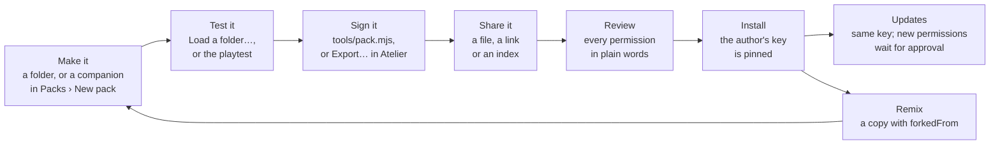

# How it works

Atelier is a Chromium browser with a companion that works in your real tabs.
Everything you can add to it is a pack: a skill, an accent colour, a tool with
its own server, a 3D game or a whole world. This page is the map. It shows
where a pack's code runs, what it can reach, how it shows up in the browser
and how it travels. The other guides fill in each part.

## Four places

- **Yours.** The person's signed-in tabs, their Claude account and their
  connectors. Only Atelier's core and their companion touch these.
- **Atelier core.** Atelier's own trusted code. It runs the companion, keeps the
  registries that every surface is drawn from, and answers every call a pack
  makes.
- **Packs.** Your code. Each pack gets its own sandbox, served from its own
  files at `atelier-pack://<id>/`. It has no Node, no device access and no
  network it didn't list. Pack code never runs in Atelier's own process, in the
  browser's chrome, on sign-in pages or on `atelier://` pages.
- **Theirs.** Everything outside: your server, the person's other devices,
  the indexes packs come from.

## Two walls, both Atelier's

Everything that enters or leaves a pack crosses one of two walls.

**The bridge** is `window.atelier`. Every call goes to Atelier's main process,
which checks who sent it (a top frame on the pack's own address), that the
pack is on, the arguments, and that the permission was granted. A refused
call rejects with a sentence that says why. See [api.md](api.md).

**The network gate** sits on the way out. An app's pages reach only the hosts
in `permissions.network` that the person granted. Atelier holds them to that list
four ways: the page's CSP, the session's request lockdown, the session's own
protocol handlers and a proxy that leads nowhere. On the way out, Atelier adds
the person's key or sign-in token to requests for the hosts it belongs to,
and takes it off any other request. Panels and tools never connect directly;
they use `atelier.fetch`, which runs in Atelier's main process. See
[servers-keys-and-sign-in.md](servers-keys-and-sign-in.md).

## Drawn or hosted

A pack shows up in two ways.

- **Drawn.** The pack gives data: a sidebar row, a command, a menu item, the
  lines of a new tab card, an accent colour. Atelier draws it with its own
  components, so no pack code runs in the browser's chrome or on the new tab
  page.
- **Hosted.** The pack gives a page: an app or a panel. Atelier shows it in a tab
  or beside the page, running in the pack's sandbox.

| Where the person sees it | In the manifest | How |
|---|---|---|
| A tab | `apps`, `panels` | Hosted. Games may go full screen. |
| Beside the page | `panels` | Hosted, in split view. |
| A sidebar row | `apps` or `panels` with `"sidebar": true` | Drawn, with a status the app sets through `atelier.status.set`. |
| The command bar | `commands`, and Open for each app | Drawn. |
| The page menu | `menus` | Drawn, for a page, a selection or a link. |
| The new tab page | `cards` | Drawn from the lines your module returns. |
| The companion's tools | `tools`, `provides` | The companion calls them. Results come back marked as the pack's output. |
| Skills | `skills` | Text the companion follows when the person types `/name`. |
| Settings › Appearance | `themes` | Drawn. |
| Sites | `boosts` | CSS on the sites listed, and scripts with `pageScripts`. Never on sign-in pages or in private windows. |
| Worlds | `worlds` | Drawn by Atelier's Worlds app. Places open apps. |

Everything a pack adds goes away when it is turned off: its rows, tools,
services and listeners, and nothing else.

## A request to your own server

Your page talks to your server directly with normal CORS, so a REST client,
socket.io or Supabase's SDK runs unchanged. The key is one the person typed
in once. Atelier keeps it in the system keychain and adds it on the way out. The
page only ever learns whether it is set. No key ever ships inside the pack.

## Atelier is the engine

AI, characters, a 3D kit, a server for phones, worlds, storage and
notifications come from Atelier, so an app needs no API key and no backend for
them. A game and a tool make the same calls for different jobs.

| Atelier gives | In a game | In a tool |
|---|---|---|
| [`atelier.ai`](ai.md): the person's own Claude, with a budget | The opponent decides where to aim. | Sorts and summarises tickets as JSON. |
| [The cast](kit-and-cast.md): their companions as characters | Pip plays the other side. | Pip, as the guide, walks someone through it. |
| [The kit](kit-and-cast.md): three.js and the companions' art | A 3D table with no build step. | Atelier's own UI, so it looks native. |
| [`atelier.server`](api.md#a-server-on-this-computer-apps): a small server | Phones on the Wi-Fi become paddles. | A colleague opens a shared screen. |
| [Your own server and keys](servers-keys-and-sign-in.md) | A leaderboard, if you want one. | The ticket API, with the person's key added by Atelier. |
| [Sign-in and connectors](connectors.md) | Not needed. | Company sign-in; the person's own connectors. |
| [Worlds](worlds.md) | A place in a world opens the game. | Not needed. |
| [Files and notifications](files-assets-notifications.md) | Saves and "your rematch is ready". | Exports to a folder and "a ticket is due in an hour". |
| [Services](services-and-events.md) | Other packs read its high scores. | The companion calls it from any chat. |

An app gets a companion's name and look. It never gets the companion's
personality, memory, chats or settings.

## The life of a pack

- A companion can build, test and propose a pack. Only a person installs one
  or grants a permission.
- The first install pins the pack id to the key that signed it. Every later
  version must be signed with the same key.
- See [getting-started.md](getting-started.md) to make one and
  [sharing-and-the-index.md](sharing-and-the-index.md) to share it.

## What a pack can never do

- Install itself, or grant itself anything.
- Run code in Atelier's own process, the browser's chrome, sign-in pages or
  `atelier://` pages.
- Read pages on sites it didn't list, or any page in a private window.
- See a key or a sign-in token. Atelier adds them to requests for the hosts they
  belong to.
- Read a companion's personality, memory or chats.
- Reach a host it didn't list, or one the person hasn't granted yet.
- Keep anything after it is removed. Its storage, logs and keys go with it.

## Which repository?

| Repository | For |
|---|---|
| **atelier-apps** (this one) | Building packs by hand: these guides, working examples and the packing tools. |
| [atelier-packs](https://github.com/3SENN/atelier-packs) | The Atelier community index: finished packs, signed and reviewed in the open, that Atelier lists on Packs › Browse. |

The two are kept apart on purpose. Every copy of Atelier reads the index, so
that repository changes only when a pack is added or updated, and every
change is reviewed. Guides and examples change often and take any fix.
